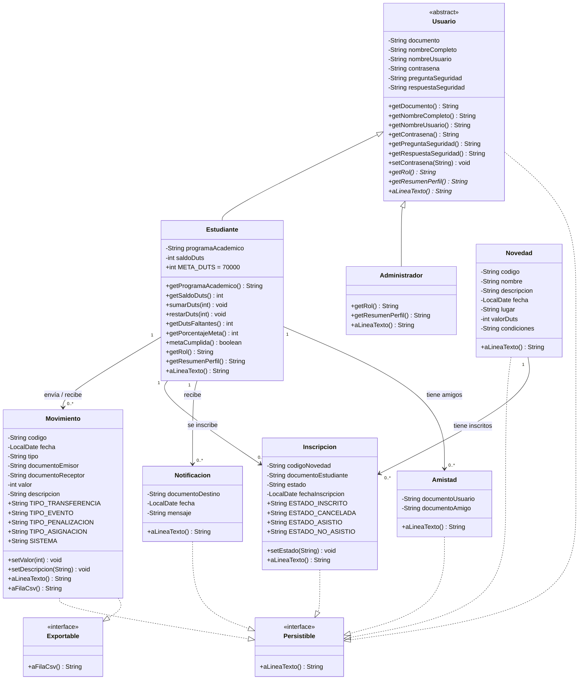
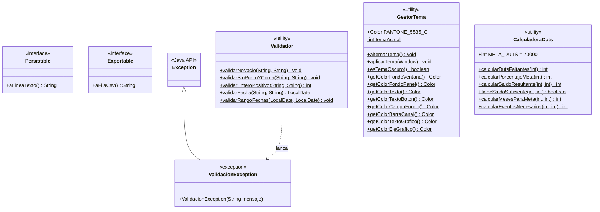
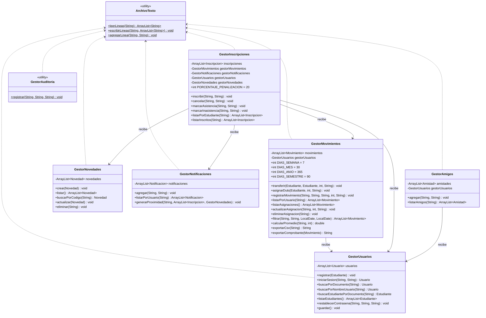
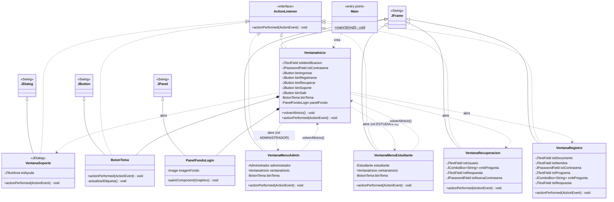
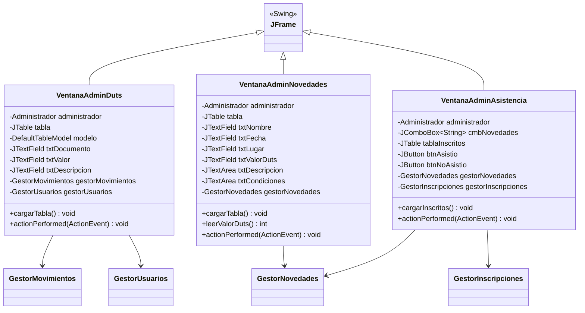
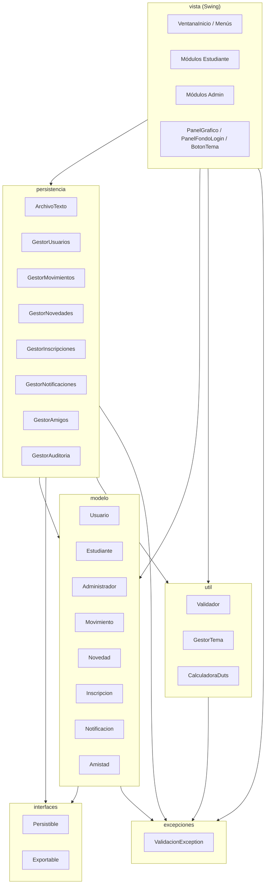
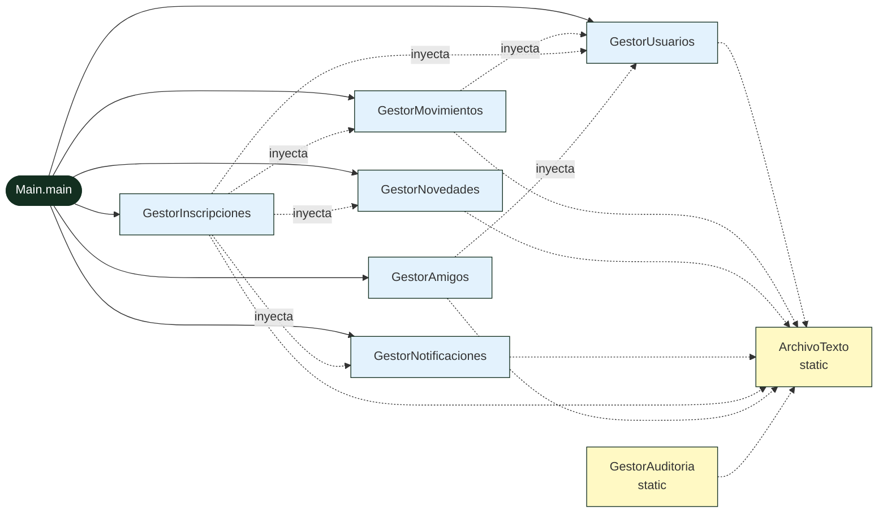
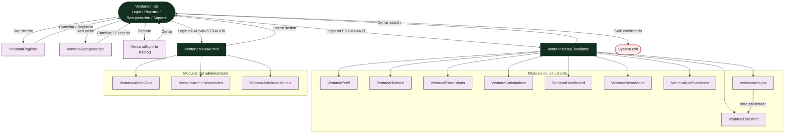
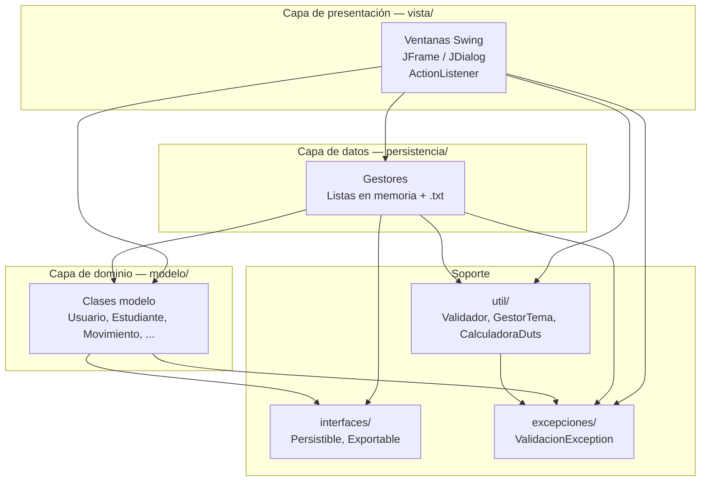

# Diagramas UML — DUTS Wallet

Diagramas de clases UML que documentan la arquitectura completa del proyecto **DUTS Wallet**, elaborados a partir de `AGENTS.md` y `plan_implementacion.md`.

Los diagramas están disponibles en dos formatos:
- **PlantUML** (`.puml`) → mayor detalle, exportables a PNG/SVG con herramientas (ver carpeta `documentacion/diagramas/`)
- **Mermaid** (este archivo) → se renderizan directamente en GitHub, GitLab, VS Code, Obsidian

---

## Índice de diagramas (versión Mermaid)

| # | Sección | Contenido |
|---|---|---|
| 1 | Paquete `modelo` | `Usuario` (abstracta), `Estudiante`, `Administrador`, `Movimiento`, `Novedad`, `Inscripcion`, `Notificacion`, `Amistad` |
| 2 | Interfaces y utilidades | `Persistible`, `Exportable`, `ValidacionException`, `Validador`, `GestorTema`, `CalculadoraDuts` |
| 3 | Paquete `persistencia` | `ArchivoTexto`, los 7 gestores y sus dependencias |
| 4 | Vista: hubs y login | `Main`, `VentanaInicio`, menús, registro, recuperación, soporte |
| 5 | Vista: módulos estudiante | 9 ventanas del estudiante (`Perfil`, `Transferir`, `Historial`, etc.) |
| 6 | Vista: módulos admin | 3 ventanas del administrador (DUTS, novedades, asistencia) |
| 7 | Arquitectura de paquetes | Organización por capas y flujo de dependencias |
| 8 | Dependencias entre gestores | Cómo `Main` crea e inyecta los gestores |
| 9 | Navegación | Flujo entre ventanas (estados) |
| 10 | Resumen por capas | Vista general de la arquitectura |

> **Los diagramas en formato PNG** con mayor resolución están en `documentacion/diagramas/*.png` (generados desde los `.puml`).

---

## 1. Diagrama de clases — Paquete `modelo`

**Pilares de POO aplicados:**
- **Abstracción:** `Usuario` es abstracta y declara `getRol()` y `getResumenPerfil()`.
- **Herencia:** `Estudiante` y `Administrador` extienden `Usuario`.
- **Polimorfismo:** ambos sobrescriben `getRol()`, `getResumenPerfil()` y `aLineaTexto()`.
- **Encapsulamiento:** atributos `private`, setters selectivos.
- **Interfaces:** `Persistible` y `Exportable`.

---

## 2. Diagrama de clases — Interfaces, excepciones y utilidades

**Pilar aplicado:** **Encapsulamiento** — toda la validación vive en `Validador`; toda la lógica de cálculo en `CalculadoraDuts` (la ventana solo la presenta).

---

## 3. Diagrama de clases — Paquete `persistencia`

**Archivos de persistencia:**

| Gestor | Archivo `.txt` |
|---|---|
| `GestorUsuarios` | `datos/usuarios.txt` |
| `GestorMovimientos` | `datos/movimientos.txt` |
| `GestorNovedades` | `datos/novedades.txt` |
| `GestorInscripciones` | `datos/inscripciones.txt` |
| `GestorNotificaciones` | `datos/notificaciones.txt` |
| `GestorAmigos` | `datos/amigos.txt` |
| `GestorAuditoria` | `datos/auditoria.txt` |

---

## 4. Diagrama de clases — Vista: hubs y login

---

## 5. Diagrama de clases — Vista: módulos del estudiante

```mermaid
classDiagram
    class JFrame {
        <<Swing>>
    }
    class JPanel {
        <<Swing>>
    }

    class VentanaPerfil {
        -Estudiante estudiante
        -JProgressBar barraProgreso
        +VentanaPerfil(Estudiante)
        +actionPerformed(ActionEvent) void
    }

    class VentanaTransferir {
        -Estudiante emisor
        -JTextField txtDocumentoReceptor
        -JTextField txtValor
        -JTextField txtDescripcion
        -GestorMovimientos gestorMovimientos
        -GestorUsuarios gestorUsuarios
        -GestorNotificaciones gestorNotificaciones
        +actionPerformed(ActionEvent) void
    }

    class VentanaHistorial {
        -Estudiante estudiante
        -JTable tabla
        -DefaultTableModel modelo
        -JComboBox~String~ cmbTipo
        -JTextField txtDesde
        -JTextField txtHasta
        -JButton btnExportarCsv
        -JButton btnComprobante
        -GestorMovimientos gestorMovimientos
        +cargarTabla() void
        +actionPerformed(ActionEvent) void
    }

    class VentanaEstadisticas {
        -Estudiante estudiante
        -GestorMovimientos gestorMovimientos
        +cargarPromedios() void
        +actionPerformed(ActionEvent) void
    }

    class VentanaCalculadora {
        -Estudiante estudianteActual
        -boolean esAdmin
        -JComboBox~String~ cmbEstudiantes
        -JTextField txtSaldoA
        -JTextField txtSaldoB
        -JTextField txtTransferenciaB
        -JTextField txtSaldoC
        -JTextField txtDutsMesC
        -JTextField txtDutsEventoC
        -GestorMovimientos gestorMovimientos
        -GestorNovedades gestorNovedades
        -GestorUsuarios gestorUsuarios
        +precargarDatosEstudiante() void
        +actionPerformed(ActionEvent) void
    }

    class VentanaDashboard {
        -Estudiante estudiante
        -PanelGrafico panelGrafico
        -JComboBox~String~ cmbTipo
        -JTextField txtDesde
        -JTextField txtHasta
        -GestorMovimientos gestorMovimientos
        +cargarDatos() void
        +actionPerformed(ActionEvent) void
    }

    class PanelGrafico {
        -int[] ingresos
        -int[] egresos
        +setDatos(int[], int[]) void
        +paintComponent(Graphics) void
    }

    class VentanaNovedades {
        -Estudiante estudiante
        -JTable tablaNovedades
        -JTable tablaInscripciones
        -GestorNovedades gestorNovedades
        -GestorInscripciones gestorInscripciones
        +cargarTablas() void
        +actionPerformed(ActionEvent) void
    }

    class VentanaNotificaciones {
        -Estudiante estudiante
        -JTable tabla
        -GestorNotificaciones gestorNotificaciones
        +cargarTabla() void
        +actionPerformed(ActionEvent) void
    }

    class VentanaAmigos {
        -Estudiante estudiante
        -JTextField txtDocumentoAmigo
        -JTable tabla
        -GestorAmigos gestorAmigos
        -GestorUsuarios gestorUsuarios
        -GestorMovimientos gestorMovimientos
        +cargarTabla() void
        +actionPerformed(ActionEvent) void
    }

    JFrame <|-- VentanaPerfil
    JFrame <|-- VentanaTransferir
    JFrame <|-- VentanaHistorial
    JFrame <|-- VentanaEstadisticas
    JFrame <|-- VentanaCalculadora
    JFrame <|-- VentanaDashboard
    JFrame <|-- VentanaNovedades
    JFrame <|-- VentanaNotificaciones
    JFrame <|-- VentanaAmigos
    JPanel <|-- PanelGrafico

    VentanaDashboard *-- PanelGrafico
    VentanaDashboard --> GestorMovimientos
    VentanaHistorial --> GestorMovimientos
    VentanaTransferir --> GestorMovimientos
    VentanaTransferir --> GestorNotificaciones
    VentanaEstadisticas --> GestorMovimientos
    VentanaNovedades --> GestorNovedades
    VentanaNovedades --> GestorInscripciones
    VentanaNotificaciones --> GestorNotificaciones
    VentanaAmigos --> GestorAmigos
    VentanaAmigos ..> VentanaTransferir : abre prellenada
    VentanaCalculadora --> CalculadoraDuts
    VentanaCalculadora --> GestorUsuarios
```

---

## 6. Diagrama de clases — Vista: módulos del administrador

---

## 7. Diagrama de paquetes

**Regla de dependencia:** las flechas siempre van "hacia abajo" (vista → persistencia → modelo → interfaces). Nunca al revés.

---

## 8. Diagrama de dependencias entre gestores (creación en `Main`)

**Orden de creación en `Main` (por dependencias):**
1. `GestorUsuarios`
2. `GestorMovimientos(GestorUsuarios)`
3. `GestorNovedades`
4. `GestorNotificaciones`
5. `GestorInscripciones(GestorMovimientos, GestorNotificaciones, GestorUsuarios, GestorNovedades)`
6. `GestorAmigos(GestorUsuarios)`

Cada gestor carga su archivo `.txt` en el constructor.

---

## 9. Diagrama de navegación (flujo entre ventanas)

---

## 10. Resumen de la arquitectura por capas

---

## Ver también

- Versión **PlantUML** con más detalle: `documentacion/diagramas/*.puml`
- Índice y guía de renderizado: `documentacion/diagramas/README.md`
- Reglas del proyecto: `AGENTS.md`
- Plan de implementación: `plan_implementacion.md`
